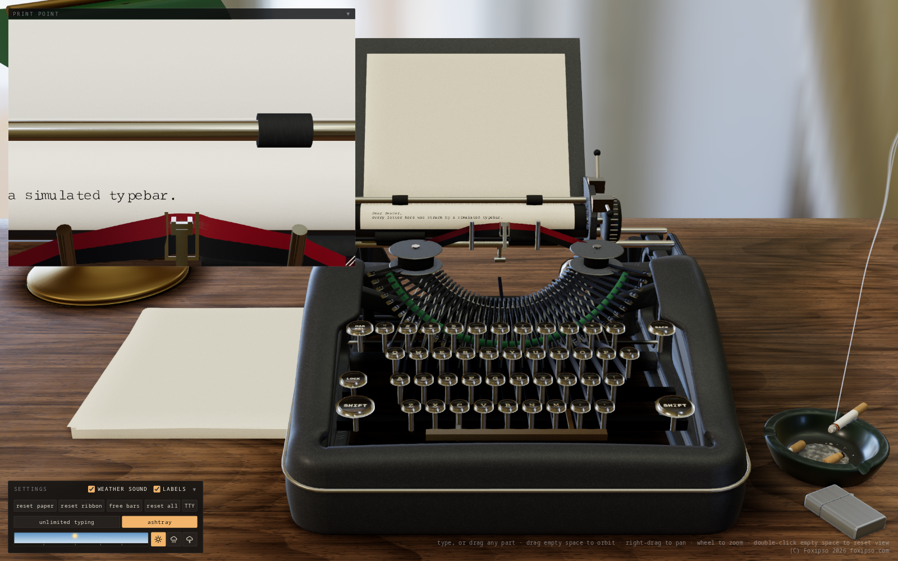
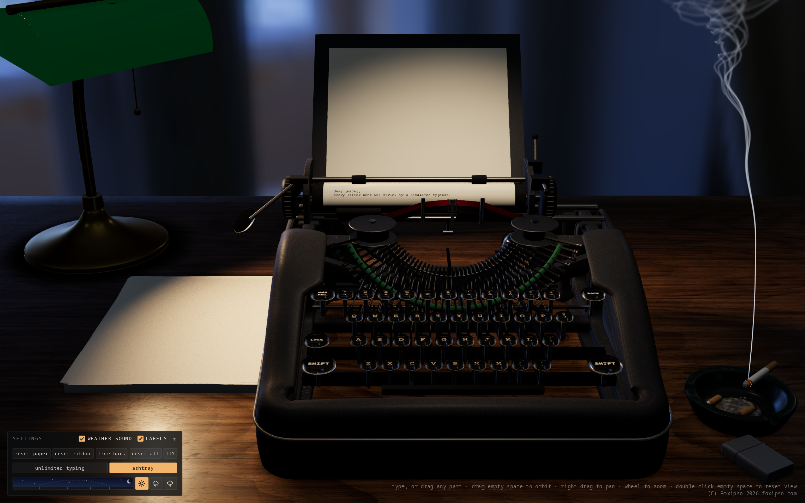
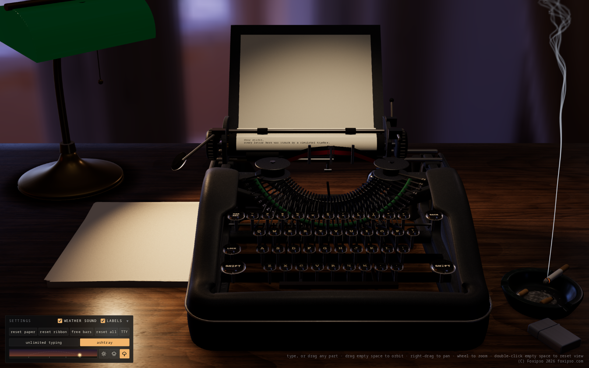

# Typewriter

A physically simulated manual typewriter in the browser (WebGL2, Web Audio). The mechanism, paper and ribbon are integrated rather than animated: print darkness, spacing, jams and skew all come out of the simulation. See `docs/ARCHITECTURE.md`.

This project was substantially created using AI-assisted tooling.



| Night, with the banker's lamp | A storm at dusk |
| --- | --- |
|  |  |

```
npm install
npm run dev        # http://127.0.0.1:5317
npm test           # Node tests
npm run e2e        # browser test (under a private Xvfb, never your display)
```

## Using it

Type on your keyboard, or drag any part of the machine: keys, typebars, levers, knobs, ribbon, paper. Drag empty space to orbit, right-drag to pan, wheel to zoom, double-click empty space to reset the view.

Click the stack of paper on the desk to the left of the machine to wind in a fresh sheet. A sheet fed off the end of the rollers, or replaced by a new one, goes to the pile on the right; click that pile to browse finished pages and save them as PDF. Pages last for the current session. Hold a platen knob and move the pointer up or down to roll it. The carriage release is a toggle: click it, slide the carriage, click it again.

The Settings panel at the bottom left sets the time of day (drag the sky strip) and the weather (rain and thunderstorms, with lightning and sound; **weather sound** turns the audio off). The banker's lamp comes on after dark, and its pull chain works. Drag the paper over the lit cigarette at your own risk; the **ashtray** button hides the ashtray and lighter.

## Machines

The **machine** menu in Settings switches between them; the choice is remembered.

- **Open-frame front-strike, c. 1926.** A manual typebar machine with a moving carriage.
- **Electric single-element office machine, c. 1971.** A motor-driven machine with a fixed platen and a carrier that travels along it. A one-revolution clutch tilts and rotates a type element to one of 88 characters and throws it at the paper at a set strength, however hard you press. Enter is its powered Return; Delete is the correction key, which backs up one space so that retyping the wrong letter lifts it off with the correction tape. Hold space or backspace to repeat. Tab runs the carrier to the next set stop, or past every stop for as long as you hold it. Click the top cover to open it. The carrier's momentum sways the table a little when it stops hard, and the lamp's pull chain swings with it.

- **IBM Displaywriter word processor, c. 1980** (for now reached with `?machine=wordproc1980&wp`). A whole system on the desk: the display station on its electronics module with a green-phosphor screen, a separate keyboard, a dual 8-inch diskette unit and a daisywheel printer. It runs our own reimplementation of the Textpack 4 editing software, written from IBM's manuals: the menus, prompts, function keys, stored codes, formats, pagination, spelling and printing behave as documented. Type on your keyboard (Alt is CODE, AltGr is ENTER, F1-F10 are the function keys, Esc is CANCL; the **keys** button lists the rest), or click the machine's keys. Documents are stored on the simulated diskettes, timed by the simulated drives, and kept between visits. Printing runs the real printwheel, carrier, hammer and platen mechanisms onto paper fed by the sheet feeder; finished pages go to the pile. Open a drive's lever to change diskettes, and use the printer's panel keys, cover and power switch. `?cold` starts with everything switched off. Design and research: `docs/displaywriter/`.

  Moving around the word processor: the camera only moves when you ask it to. It stands at one of four **stations**, each seen head-on: the Desk overview, the Printer, the Computer and the Diskettes. The arrows at the left and right edges of the window walk along the row of units (hover to see where one goes; on a touch screen they are always named), and the bar at the top lists the stations. Within a station, the bar's second row has its **focus items**, closer looks such as the Keyboard, Screen, Controls and Rear of the computer, the Slots, Levers and Desk file of the diskette unit, and the Panel, Mechanism and Paper path of the printer. You can also click the object itself: anything that will move the camera is outlined when you hover over it. **Back** returns from a focus item to its station and from a station to the desk. Clicking a key or a control never moves the camera. To look around freely, switch on **free view** (the ◎ button): drag to orbit, right-drag or Shift-drag to pan, wheel or pinch to zoom; switching it off returns to the nearest station. Shortcuts, which the machine never sees: Ctrl+Shift+← and → for the neighbouring station, Ctrl+Shift+↓ for Back, Ctrl+Shift+↑ for free view, or keypad 4, 6, 2 and 5 (Escape stays the machine's CANCL). `?view=computer/keyboard` starts at a view. The **Screen** card at the top left shows the display's picture flat and legible, whatever the camera shows: fold it from its header, resize it from its corner, or hide it with the **screen card** button in Settings.

## Audio

Keystrokes and carriage sounds are samples triggered and scaled by the physics, cut from "ASMR Typing on 1950s Typewriter". Bar-on-bar clashes come from a modal model, which also voices everything until the samples load. The electric machine has its own sprite, cut from recordings of a real one and triggered by its clutches and carrier; only its motor hum and key clicks are synthesised. See `public/assets/audio/SOURCES.md`.

## Terminal mode

The machine can be used as a paper teletype on a real shell on your own computer. Everything you type goes to the
shell, and the machine prints only what the shell sends back: every character is a key press on a real bar, through
the real strike, ink and sound paths. It is not a screen terminal: there is no cursor addressing and no scrolling back.

To start it, run the bridge explicitly in one terminal and the page in another, then open the URL the bridge prints:

```
npm run term       # prints http://127.0.0.1:5317/?terminal=<token>&termport=5318
npm run dev
```

The bridge is never started by anything else. Alternatively click TTY in the panel's action row and paste that URL.
Leaving terminal mode (the exit button, or closing the tab) hangs up the shell.

- **Keys.** Plain keys, Enter, Backspace, Tab, Ctrl-letter and the arrow keys go to the shell. Ctrl-C also clears the
  print queue. Browser-owned shortcuts (Ctrl-W, Ctrl-T, Ctrl-N, F5) are not delivered; paste with Ctrl-Shift-V.
- **Printing.** Lines wrap at the machine's printable width (75 columns at 10 cpi), which the shell is told as
  `COLUMNS`. `TERM=dumb`, `PAGER=cat`. Tabs are expanded to spaces, BS steps the carriage back and the next character
  overstrikes (a shell's BS, space, BS erase counts as one step back, since nothing can be erased on paper), BEL rings the bell. A new sheet is fed automatically when one runs out.
- **Pace.** Standard pace is set by the mechanism's own state (key up, escapement at rest, carriage arriving) and is
  about 8 characters a second (slower across shift changes; a carriage return costs about a second). The **fast** button
  switches on `typing.unlimited` (no bar collisions, one pitch per keystroke), about 35 characters a second, which is
  not realistic; it goes back to the panel's own setting when you leave fast mode.
- **Prompt.** Under bash, your `~/.bashrc` still runs, then the prompt is set to a plain `$ `, since a screen prompt would be typed out in full for every command.
- **Unsupported.** Full-screen programs (`vim`, `top`, `less` without `PAGER=cat`, and anything using the alternate
  screen or cursor addressing): the strip at the top of the page says so when one is detected. Colours and titles are
  stripped. Non-ASCII characters print as `?`.

### Security model

This exposes a shell to a browser, so the bridge (`tools/term-server.py`, Python standard library only) is deliberately
narrow:

- It binds `127.0.0.1` only and has no option to bind anything else. It never listens on any other interface.
- Every run generates a new 256-bit random token, printed inside the page URL. A connection without the correct token
  is refused (constant-time comparison). The token lives only as long as that run.
- The `Origin` header must be the local page's origin (`--page-origin`, default `http://127.0.0.1:5317` and
  `http://localhost:5317`) and the `Host` header must be `127.0.0.1` or `localhost` on the bridge's port, which covers
  cross-site pages and DNS rebinding.
- One session at a time; a second connection is refused while one is open. When the page goes away the shell is hung up.
- It runs only your own `$SHELL` as you, with `TERM=dumb`, `PAGER=cat` and `COLUMNS` set; no other program and no
  remote access.
- Stop it with Ctrl-C in its terminal. Treat the printed URL like a password while it is running.

Output back to the page is flow controlled: when the print queue is long the bridge stops reading from the PTY, so a
long-running program blocks instead of filling memory (a real teletype's serial line behaved the same way).

## Credits and licences

The code is released under the MIT licence (see `LICENSE`).

- HDRI: "Combination Room" from Poly Haven, CC0.
- Fitted acoustic data and proofs: see `public/assets/audio/SOURCES.md`.
- Generated assets and their caveats: see `docs/assets.md`.
